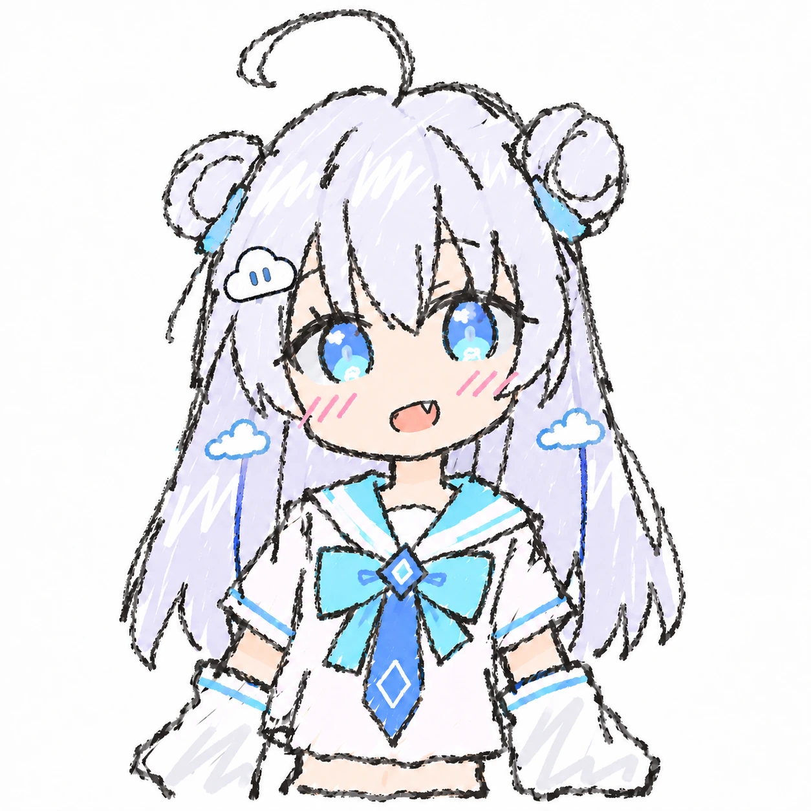

# 小云粗糙数字涂鸦



基于 [`../yun-alpha.png`](../yun-alpha.png) 生成的 AI 衍生图。保留银白双团子头、呆毛、蓝色星瞳、小虎牙、云朵发饰和蓝白水手服，并将侧边发卡替换为 el-bot 小云云朵 logo 的白色发饰版本。

- 生成工具：Codex 内置 `image_gen`（GPT Image）
- 生成日期：2026-11-08
- 画布：1254 × 1254，1:1，纯白背景，WebP 质量 92
- 原设画师：[Ai_Floverse](https://twitter.com/Ai_Floverse)
- 授权：遵循仓库 [CC BY-NC-SA 4.0](../../CC-BY-NC-SA-4.0) 说明

图中的 el-bot 云朵图形来自 [YunYouJun/el-bot](https://github.com/YunYouJun/el-bot) 的品牌素材 `docs/public/logo.png`。最终发卡使用白色云朵与品牌蓝竖眼，以便在银白头发上保持清晰。

## 参考提示词

### 1. 基础风格

```text
将参考图片中的角色转换为日系粗糙数字涂鸦风格。

整体画风：
一张极其随意、粗糙、稚拙的日系萌系动漫人物数字涂鸦，仿佛使用普通绘画软件中的粗糙蜡笔、马克笔快速绘制完成。保留原角色的辨识度、发型、发色、五官特征、服装、配饰和标志性表情。

线稿：
- 使用明显的黑色粗糙笔触勾勒人物。
- 线条粗细极不均匀，部分突然加粗，部分断开。
- 轮廓松散、不准确、略微歪斜。
- 线条具有明显的手绘颗粒感和涂抹感。
- 不追求精准描边，允许线条错位、重叠和不完整。
- 禁止精细流畅的矢量线稿。

上色：
- 使用大面积不透明的简单平涂。
- 颜色略微溢出轮廓，允许漏涂和白色空隙。
- 阴影使用少量粗糙的灰色或同色系深色笔触。
- 高光使用随意涂抹的白色短笔触。
- 保留蜡笔、粉彩和马克笔混合的粗糙质感。
- 不使用复杂渐变、精细光影和丰富色彩层次。

人物五官：
- 保留原角色的眼睛颜色、眼型和标志性神态。
- 五官适当简化，眼睛使用粗黑线条和简单色块表现。
- 嘴巴尽量简洁，鼻子可以省略。
- 面部可以添加少量随意的粉色腮红笔触。
- 表情保留原角色特点，不要擅自改变性格气质。

头发与服装：
- 完整保留原角色最具辨识度的发型和发色。
- 头发由几块大面积色块构成，不绘制大量细碎发丝。
- 服装保留原有颜色、轮廓和标志性配饰。
- 衣服褶皱和装饰高度简化。
- 不要擅自更换服装或增加原图不存在的配饰。

构图：
- 1:1 正方形画布。
- 角色半身像，头部比例略大。
- 人物居中，保留自然的白色留白。
- 纯白背景，不添加文字、复杂场景或装饰边框。

最重要的风格限制：
画面必须粗糙、潦草、简单、稚拙，像随手画出来的可爱动漫涂鸦，而不是精致插画刻意模仿草稿。

禁止自动精修，禁止精细线稿，禁止复杂头发结构，禁止细腻渐变，禁止 3D 效果，禁止过度光影，禁止增加复杂服装细节。

最终效果：低完成度、粗黑轮廓、大色块平涂、随意白色高光、明显蜡笔颗粒感的日系动漫数字涂鸦。
```

生成时另附英文约束，要求保留银白长发、双团子头、单根呆毛、天蓝星瞳、小虎牙、云朵发饰、六边形发卡和蓝白水手服，并明确禁止增加额外配饰。

### 2. 替换发卡为 el-bot logo

输入图：第一张为基础涂鸦，第二张为 el-bot 官方云朵 logo。

```text
Use case: precise local edit.
Input images: Image 1 is the edit target — the rough crayon/marker Japanese anime doodle of Xiao Yun. Image 2 is the official current el-bot / Xiao Yun brand logo: a solid blue (#4B86C8) three-lobed cloud shape with a flat bottom, containing two rounded vertical white slit eyes.

Primary request: Replace ONLY the small blue hexagonal hair clip with the white letter "Z" on the viewer's left side of her head (her right temple, just beside her left eye from our view) with the el-bot cloud logo from Image 2, worn as a hair clip.

Requirements for the new hair clip:
- The logo must read clearly as the exact three-arc cloud silhouette with two vertical white eyes from Image 2, not a hexagon, not a robot head, no letter Z, no text.
- Redraw it in the same rough, crude crayon/marker doodle language as the rest of Image 1: rough hand-drawn dark blue/black outline, flat opaque blue fill, slightly uneven and wobbly edges, small white gaps, a little crayon grain. It should look hand-drawn, not a clean vector sticker.
- Keep it small, about the same size as the original hair clip, attached to the hair at the same position and with a natural slight tilt. It may overlap a few hair strands but must stay clearly visible.
- Preserve the hair underneath and keep the area around it natural.

Preserve everything else exactly: same character, same silver-white/lilac hair, same double buns and ahoge, same blue starry eyes, same fang, blush marks, expression, sailor outfit, bow, sleeves, pose, composition, white background, line style and texture. Do not change the face, hair color, clothing, or background. Do not add any new accessories, text, watermark, or decoration.
```

### 3. 白色云朵发饰版本

输入图：第一张为已替换发卡的涂鸦，第二张为 el-bot 官方云朵 logo。

```text
Use case: precise local color edit.
Input images: Image 1 is the edit target — the rough crayon/marker doodle of Xiao Yun wearing the el-bot cloud logo as a hair clip on the viewer's left side. Image 2 is the official el-bot cloud logo shape reference.

Change ONLY the color scheme of that cloud hair clip:
- Make the cloud body pure white (with maybe a tiny hint of pale blue-gray rough shading), instead of blue.
- Make the two vertical rounded eyes brand blue #4B86C8, instead of white.
- Keep the exact same three-arc cloud silhouette with flat bottom, same small size, same position, same slight tilt.
- Keep a rough, uneven dark blue/black crayon outline around the white cloud so it stays clearly visible against the silver-white hair.
- Keep the rough hand-drawn edges, flat opaque fills, tiny white gaps and crayon grain; it must still look hand-drawn, not a clean vector sticker.

Preserve everything else exactly: same character, hair color, buns, ahoge, face, starry blue eyes, fang, blush, expression, sailor outfit, bow, sleeves, pose, composition, white background, and line style. Do not change anything else, do not add accessories, text, or decoration.
```
